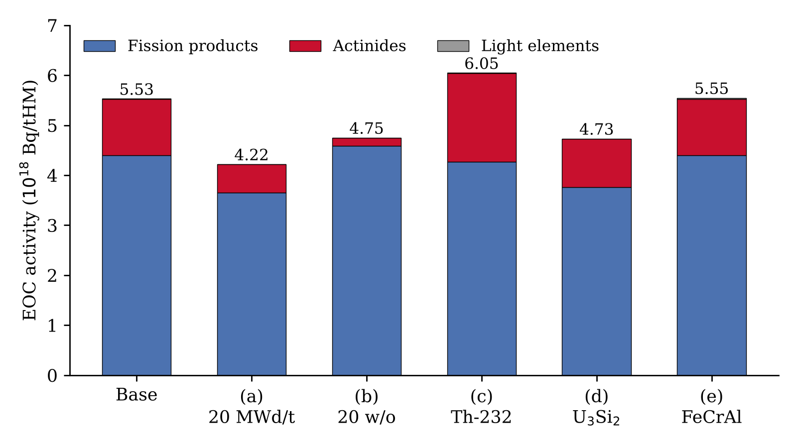

# CAREM-25 End-of-Cycle Activity with KORIGEN

End-of-cycle (EOC) radionuclide inventory of the CAREM-25 small modular reactor, calculated
with the point depletion code **KORIGEN** by adapting the VVER-1000 example input deck.

> NEM 467 Application 1, Hacettepe University, Department of Nuclear Engineering.

## Problem

CAREM-25 is a 100 MWt integral PWR with 61 hexagonal assemblies of 108 fuel rods each. The
task was to find the total EOC activity of the core and the activities of 15 nuclides
(U-233, U-235, U-238, Pu-239, I-131, I-132, Cs-137, Cs-134, Sr-90, Ce-144, Ba-137m, Xe-133,
Xe-135, Kr-85m, Kr-88), then repeat the calculation for five changes to the core:

| Case | Change |
|:--|:--|
| (a) | Burnup of 20 MWd/t |
| (b) | 20 w/o U-235 enrichment |
| (c) | Half of the U-238 replaced by Th-232 |
| (d) | U₃Si₂ fuel instead of UO₂ |
| (e) | FeCrAl cladding instead of Zircaloy-4 |

## Core Data and Method

| Parameter | Value |
|:--|:--|
| Fuel rods | 61 × 108 = 6588 |
| Fuel | UO₂, 3.1 w/o U-235, 95% of theoretical density |
| Pellet diameter / active length | 0.76 cm / 140 cm |
| Cladding | Zircaloy-4, OD 0.90 cm, thickness 0.0625 cm |
| Gap | helium (assumed) |
| Heavy metal in core | 3.840 tHM |
| Specific power | 100 MW / 3.840 tHM = 26.04 MW/tHM |
| Burnup / irradiation time | 24 MWd/kg / 921.6 days |

KORIGEN works per tonne of heavy metal, so the reactor power was converted to MW/tHM from
the rod geometry. Each case changes only the affected lines of `vver.k.i`. The decay start
step on line 19 was changed from 10 (VVER example) to 18, so the decay calculation starts
from the real end of irradiation.

Case (d) is not just a material swap. The same pellet holds 17% more uranium as U₃Si₂, so at
the same 100 MWt the specific power drops to 22.24 MW/tHM and the irradiation time grows to
1078.9 days.

## Key Results

| Quantity | Value |
|:--|:--|
| Total EOC activity (base) | 5.53 × 10¹⁸ Bq/tHM |
| Total EOC activity, whole core | 2.12 × 10¹⁹ Bq (5.74 × 10⁸ Ci) |
| Decay heat at shutdown | 1.50 MW/tHM (5.8% of operating power) |
| (a) 20 MWd/t | total 76% of base, Cs-137 about 1/1160 of base |
| (b) 20 w/o | Pu-239 0.35×, Cs-134 0.20×, Xe-135 2.3× |
| (c) Th-232 | U-233 × 4.7 × 10⁶, Pa-233 6.5 × 10¹⁷ Bq, total +9% |
| (d) U₃Si₂ | short-lived nuclides 0.854×, same as the power ratio |
| (e) FeCrAl | listed nuclides unchanged, activation products 4.7× |

The total at shutdown follows the power more than the burnup: case (a) ran for only 18 hours
and still reached 76% of the base total. The long-lived nuclides do the opposite and follow
the burnup.

Full calculations and discussion are in the [project report](docs/CAREM25_KORIGEN_Report.pdf).

## Repository Contents

| Path | Description |
|:--|:--|
| `docs/CAREM25_KORIGEN_Report.pdf` | Project report |
| `runs/<case>/vver.k.i` | KORIGEN input deck of each case |
| `runs/<case>/vver.o` | Main output (concentrations, activities, decay heat) |
| `runs/<case>/vver.3.o` | Input echo as read by KORIGEN |
| `images/` | Figure used in this README |

The KORIGEN code and its data libraries are course material and are not included.

## Author

**Emre Sakarya**, Nuclear Engineering, Hacettepe University (Student ID: 2230386062).
